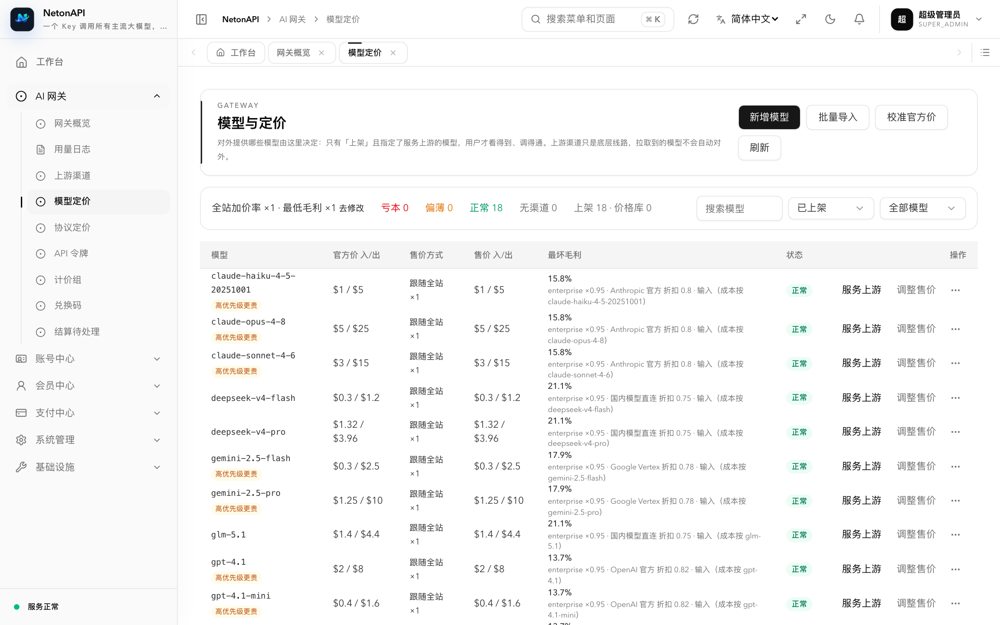

## Neton Cloud: an API relay platform built on NetonAPI

[Neton Cloud](https://neton.cloud) is an API relay operated with NetonAPI: sign up, create an API key and call GPT, Claude, Gemini,
DeepSeek, Qwen, GLM, Kimi, Grok and more, billed at official prices.

## A quick look

| Gateway overview: revenue, cost, margin | Negotiated pricing: per-model discounts for a key account |
|---|---|
|  |  |
| **Model pricing: worst margin across channels** | **User console: models and prices** |
|  |  |

[Full comparison with new-api and one-api →](/compare)

