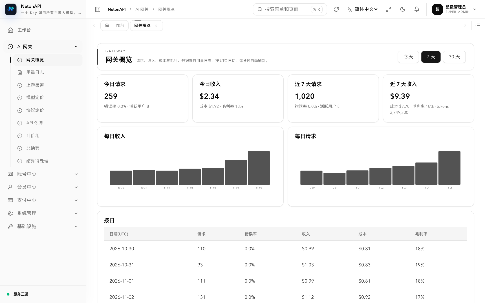
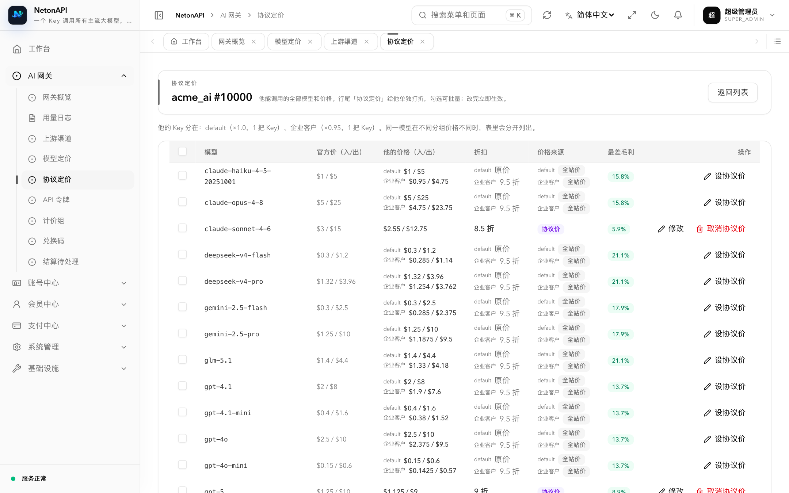
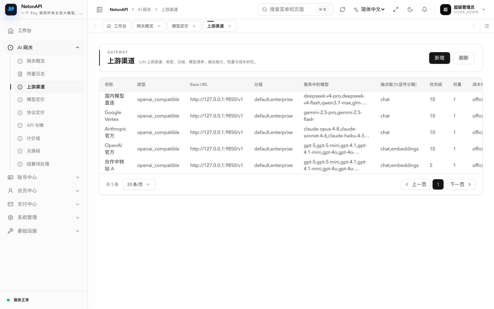
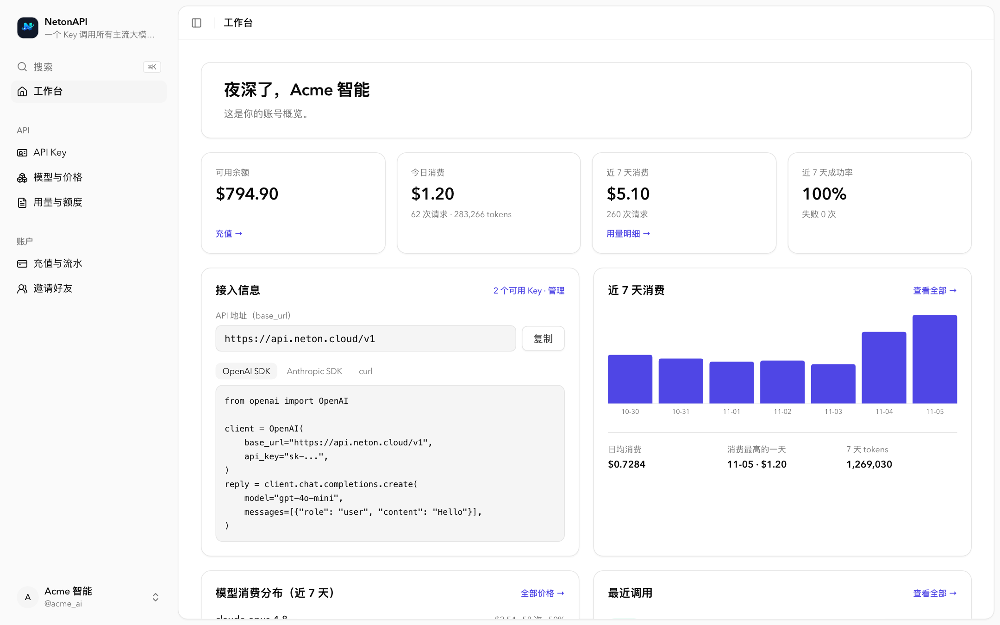
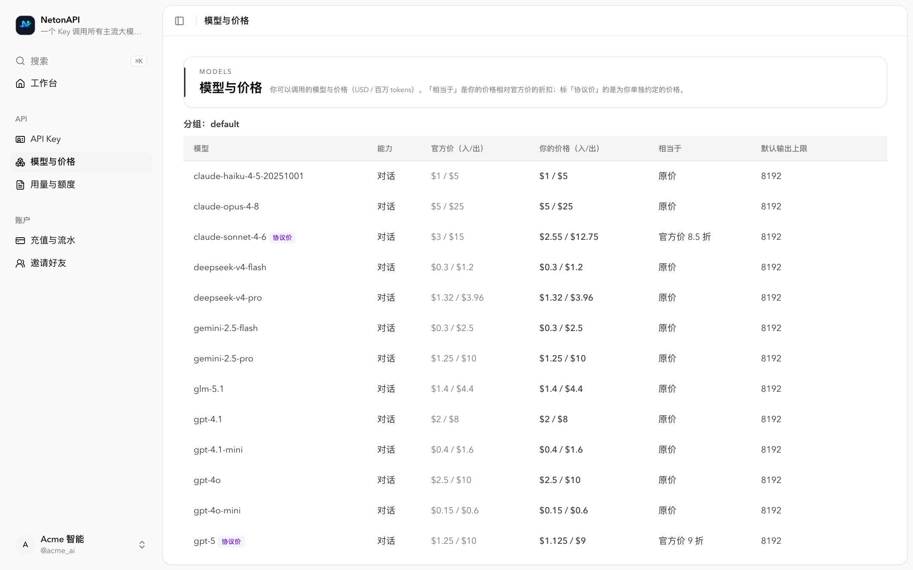

## Neton Cloud：基于 NetonAPI 构建的 API 中转站平台

[Neton Cloud](https://neton.cloud) 是用 NetonAPI 运营的 API 中转站：注册即可创建 API Key，按官方价计费，调用 GPT、Claude、Gemini、DeepSeek、Qwen、GLM、Kimi、Grok 等主流模型。
想看看 NetonAPI 跑起来是什么样，或者只想直接用，[去 Neton Cloud 注册试用](https://neton.cloud)。

## 看一眼

**运营侧**

| 网关概览：收入、成本、毛利 | 协议定价：给大客户逐模型打折，实时显示毛利 |
|---|---|
|  |  |
| **模型定价：每个模型在每条渠道上的最差毛利** | **上游渠道：每条渠道的拿货折扣** |
|  |  |

**用户侧**

| 控制台 | 模型与价格：你的价格、相当于官方价几折、协议价 |
|---|---|
|  |  |

## 和主流开源中转站有什么不同

| | NetonAPI | new-api | one-api |
|---|---|---|---|
| 定价方式 | 官方价为锚，「官方价 N 折」 | 模型 × 补全 × 分组倍率 | 分组 × 模型 × 补全倍率 |
| 按用户 × 模型的协议价 | 有 | 按用户分组倍率 | 按用户分组倍率 |
| 渠道真实成本 / 毛利保护 | 有，低于成本保存不了 | 公开文档未涉及 | 公开文档未涉及 |
| 展示单价 = 扣费单价 | 是，逐笔可对账 | 预扣后多退少补 | 预扣后结算 |
| API Key | 只显示一次，只存哈希 | 可随时查看 | 可随时查看 |
| 部署 | 单个原生可执行文件 | Go / Docker | Go / Docker |

[查看完整对照 →](/compare)

