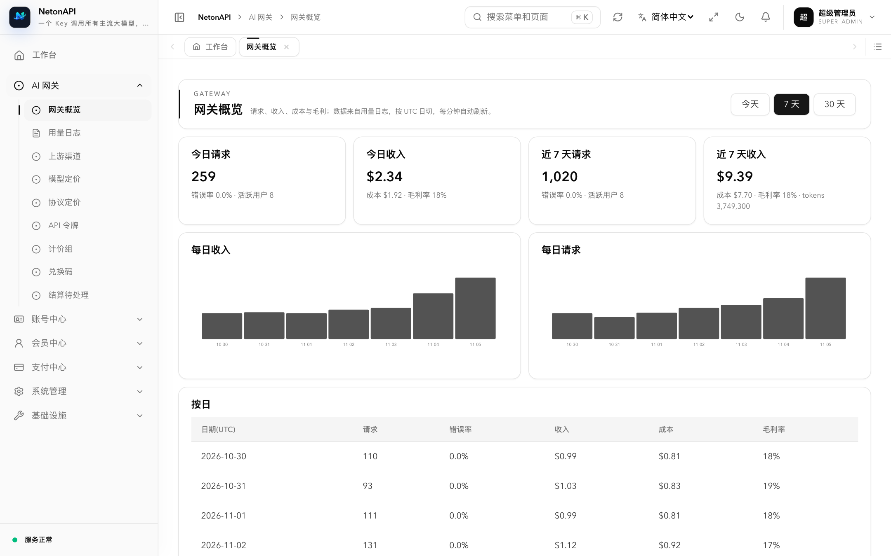
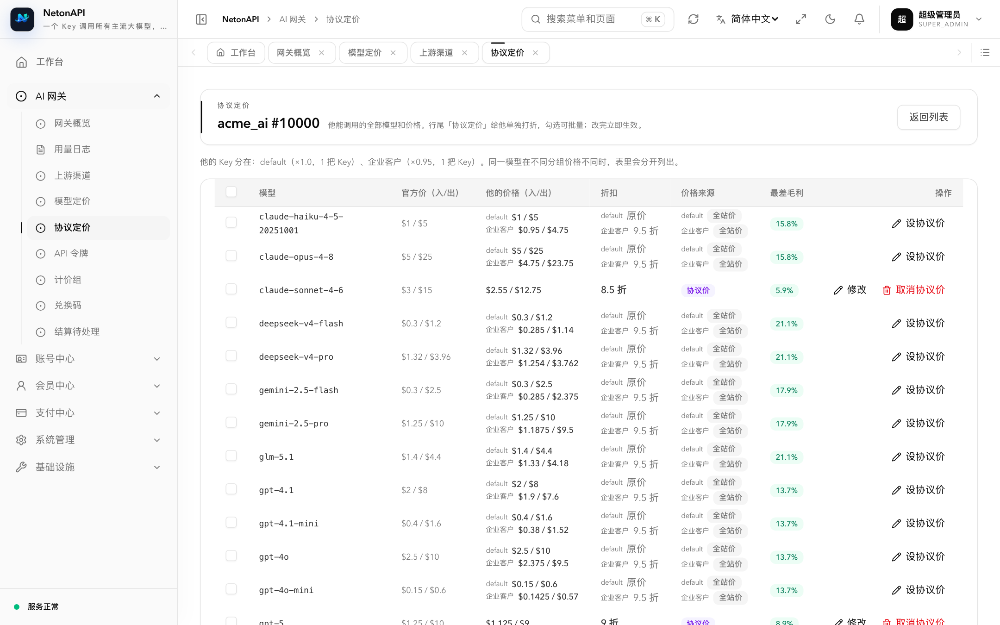
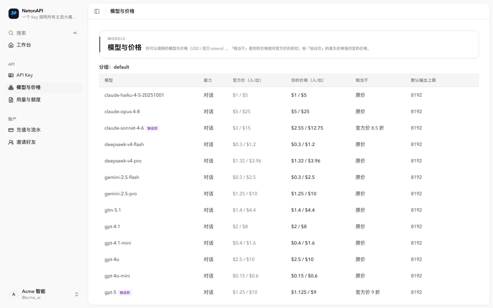
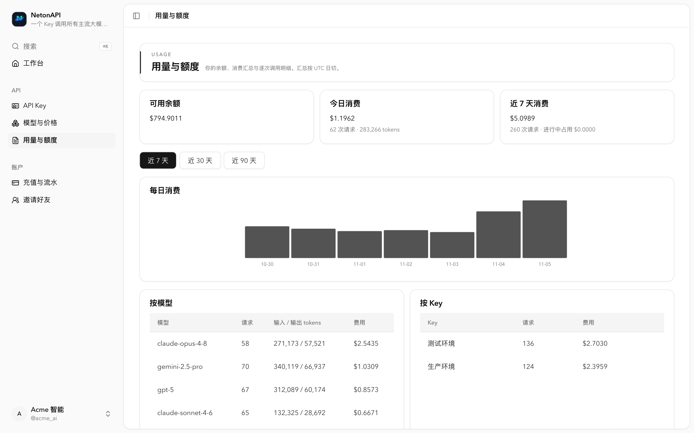

# NetonAPI 1.0.0: an AI API relay designed from the operator's side

2026-11-06

NetonAPI is a self-hosted relay for large-model APIs: one key for OpenAI, Claude, Gemini, DeepSeek, Qwen, GLM, Kimi, Grok and more,
billed per token, with an admin console and a user console included. Today we release 1.0.0.

## Why another relay

Most open-source relays start from "forward the request" and bolt billing on as stacked ratios. Running a relay as a business is hard for other reasons:
**what each model sells for, what it costs, whether a request made money, whether a key-account discount loses money somewhere, and whether the user's bill matches the price they saw.**
NetonAPI was designed around those questions from the first line of code.

### 1. Anchored to the official price

Customers compare against the official price ("Claude is $3 officially, 70% here"). NetonAPI writes the sale price as "official × markup",
and discounts for a group or a single key account as "N% of official" — when the official price changes, they follow, and the promise stays true.
No layers of ratios to convert.

### 2. Every channel has a real cost, and loss-making prices can't be saved

Each upstream channel records its cost: a discount off the official price, pulled automatically from an upstream relay's price API, or entered per model;
unusual cost changes are held until an operator confirms them.
Every price — site, group, or a user's negotiated price — is checked against **every channel that would actually serve it** before saving, and **below cost is refused**.
The pricing health check lists the worst margin of each group × channel combination; the profit dashboard shows revenue, cost and losses by group and channel.

### 3. The unit price shown is the unit price charged

Charge = tokens × the unit price the user sees in the console, rounded up per component; the pricing page, the console and the bill are the same number and can be reconciled request by request.
When upstream usage data is irregular (more cached tokens than input, missing cache price…), the conservative reading is used — never undercharging, never giving cache hits away.

### 4. A two-phase ledger

Each request reserves an upper bound first and settles on actual usage, with the price snapshot frozen per request — changing prices mid-flight affects nothing in progress.
After a crash the ledger recovers automatically; anything unclear goes to a manual review queue, **never auto-refunded, never double-charged**.

### 5. An admin console built for operators

- **Negotiated pricing**: find a user, set "N% of official" per model (or in bulk), and see their price and your margin live.
- **Billing group decided by API key**: dedicated lines and special rates attach to a specific key and take effect immediately.
- **Menu- and button-level permissions** with four preset roles: gateway ops, finance, support, read-only.
- **API keys are shown only once** at creation and only their hash is stored; upstream keys are encrypted; payment secrets are write-only.

## A quick look

| Overview: revenue, cost, margin | Negotiated pricing: per-model discounts with live margin |
|---|---|
|  |  |
| **User console: models and prices** | **User console: usage and balance** |
|  |  |

## What 1.0.0 includes

- **Endpoints**: OpenAI (Chat Completions, Responses, Embeddings, Images, Audio, Rerank), Anthropic Messages and native Gemini,
  converted between inbound and upstream protocols **in any direction** (tool calls, images, thinking and cache usage preserved), streaming and non-streaming; Claude Code and official SDKs work as is.
- **Upstreams**: OpenAI-compatible (including other relays), Azure OpenAI, Anthropic, Gemini, AWS Bedrock, Vertex AI.
- **Routing and failover**: priority + weight, automatic failover (including when an upstream reports "no such model"), key suspension and cooldown, scheduled probes, long answers never truncated.
- **Billing**: per token, per call and long-context tiers; cache reads and writes priced separately; site, group and negotiated prices, reconcilable per request.
- **Money**: manual top-up, redemption codes, online payment (Alipay and aggregated providers, extensible), full balance ledger.
- **Operations**: overview (revenue / cost / margin, daily trend, top models and users, channel health), price source sync and calibration, price history, usage logs, settlement review, Prometheus metrics.
- **Users**: sign-up and login (password, SMS code), self-service API keys (budget, expiry, model scope, IP allowlist), usage and billing, price list, integration guide.
- **Deployment**: **a single native executable** compiled with Kotlin/Native, no JVM at runtime; PostgreSQL (Redis optional).

## Compared with mainstream open-source relays

| | NetonAPI 1.0 | new-api | one-api |
|---|---|---|---|
| Pricing | Anchored to official price, "N% of official" | Model × completion × group ratios | Group × model × completion ratios |
| Per-user × per-model negotiated price | Yes | Via user group ratio | Via user group ratio |
| Real channel cost / margin protection | Yes, below cost can't be saved | Not covered in public docs | Not covered in public docs |
| Shown unit price = charged unit price | Yes, reconcilable per request | Pre-deduct, then refund or top up | Pre-deduct, then settle |
| Ledger | Two-phase reserve → settle, crash recovery | Pre-deduct + settle | Pre-deduct + settle |
| API keys | Shown once, hash only | Viewable any time | Viewable any time |
| Protocol conversion | OpenAI / Anthropic / Gemini, any direction | Four text protocols | Unified to OpenAI |
| Upstream types | 6 (covering every OpenAI-compatible site) | Dozens | 30+ |
| Task APIs (MJ, video) | Not yet | Yes | No |
| Deployment | Single native executable, PostgreSQL | Go / Docker, several databases | Go / Docker, SQLite / MySQL |

See the [full comparison](/compare). The new-api and one-api columns are based on their public documentation (2026-11).

## Known limitations

Stated plainly:

- No task-style APIs such as Midjourney, Suno or video generation; fewer upstream types than new-api (though any OpenAI-compatible site works).
- No third-party login (GitHub, OIDC…) or two-factor authentication for users yet.
- PostgreSQL only.
- The Docker / compose path has not yet been run on a real Docker host; the bare-metal install in DEPLOY.md is recommended.

## Repositories

- Server: [netonapi/netonapi](https://github.com/netonapi/netonapi)
- Admin console: [netonapi/netonapi-admincp](https://github.com/netonapi/netonapi-admincp)
- Website (portal, pricing page, user console): [netonapi/netonapi-web](https://github.com/netonapi/netonapi-web)
- Deployment guide and end-to-end tests: [DEPLOY.md](https://github.com/zoujiaqing/nanogate/blob/main/DEPLOY.md)

License: Apache-2.0.
